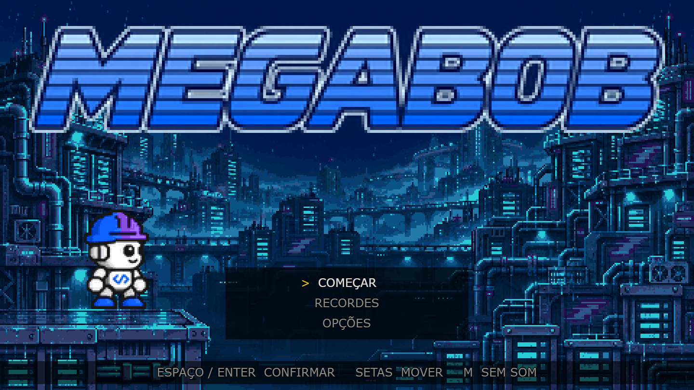
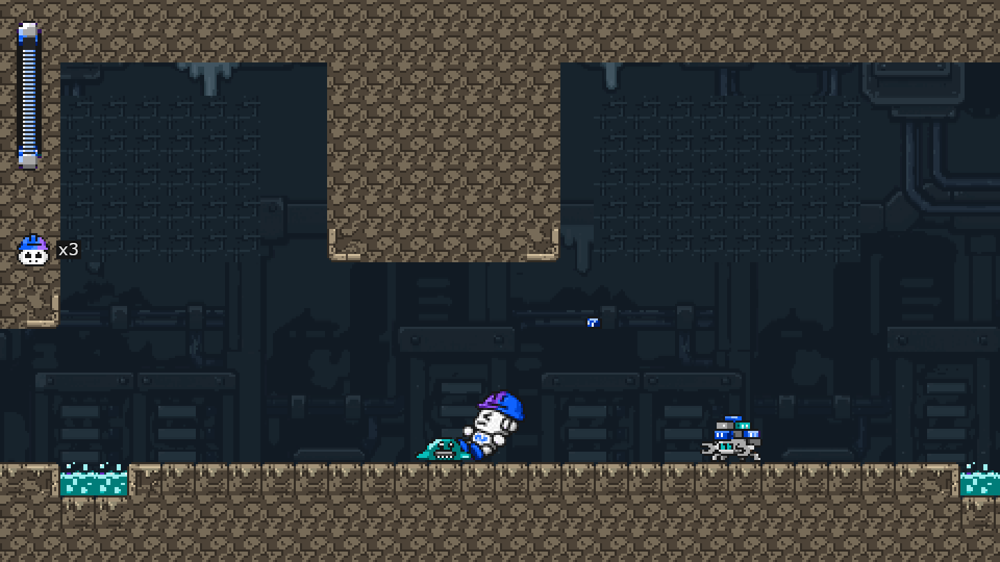
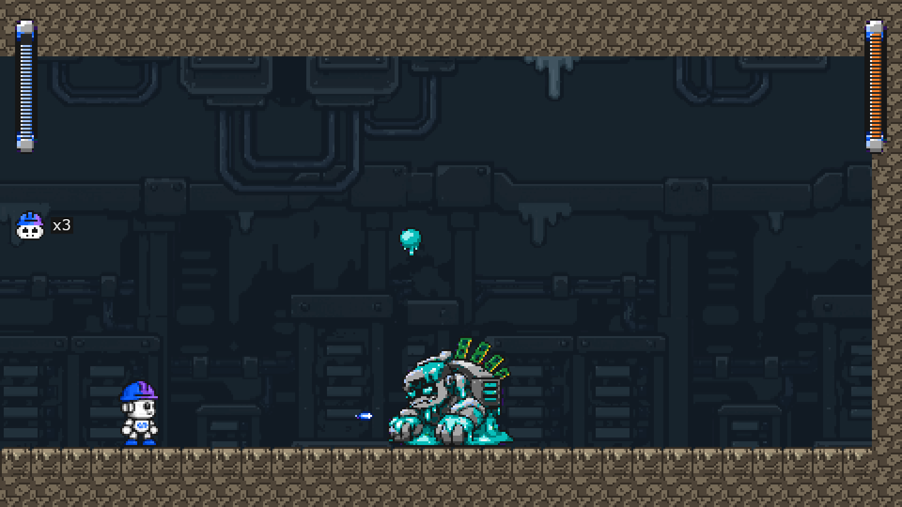

# Megabob

Um jogo de plataforma e ação em **16 bits**, estrelado pelo **IBM Bob**. Explore um mundo de bugs de software, derrote chefes robóticos e transforme suas armas em novas maneiras de atravessar as fases.

## Telas do jogo

### 1. Menu inicial



### 2. Gameplay



### 3. Boss



## A aventura

- **Memory Leak:** data center inundado, lodo crescente e o Garbage Collector.
- **Race Condition:** esteiras, plataformas móveis e a arma Mutex Lock.
- **Null Pointer:** blocos que desaparecem, passagens ocultas e tiros que atravessam paredes finas.
- **Tech Debt:** a fortaleza final, liberada após vencer os três chefes.
- Quatro peças de **Armadura Firmware**, armas com fraquezas entre chefes, checkpoints e progresso salvo no navegador.
- Interface em português, controles remapeáveis, gamepad e ajustes de áudio e efeitos visuais.

## Executar localmente

Requer Node.js compatível com as versões do projeto; o ambiente de desenvolvimento usa Node.js 26.

```sh
npm ci
npm run dev
```

Abra [localhost:5173](http://localhost:5173). Para gerar e conferir a versão de distribuição:

```sh
npm run build
npm run preview
```

O build estático fica em `dist/`. O progresso é salvo neste navegador; mudar de navegador ou limpar seus dados não transfere o save.

Para preparar o upload HTML5 no itch.io, execute `npm run package:itch`. O arquivo gerado é `release/megabob-html5.zip`; use embed de **960 × 540** e habilite tela cheia. Veja a [configuração e validação do deploy](docs/itchio.md).

## Controles padrão

| Ação | Teclas |
|---|---|
| Mover | Setas ou WASD |
| Pular | Espaço |
| Atirar / carregar | Z ou L; segure para carregar e solte para disparar |
| Dash | C ou Shift esquerdo |
| Trocar arma | Q / E ou vírgula / ponto |
| Pausar | Esc ou P |
| Confirmar nos menus | Enter, pulo ou tiro |
| Ativar / desativar som | M |

O menu **Opções** permite remapear teclado e gamepad. O dash no ar é liberado pelas Turbo Boots.

## Desenvolvimento

Phaser **3.90**, TypeScript, Vite e Vitest. Resolução interna de **480 × 270**, com escala inteira para preservar o desenho dos sprites.

```sh
npm test
npm run typecheck
npm run build
```

As regras de movimento, combate e progresso ficam em `src/systems/`; as fases são declaradas em `src/stages/`; cenas e entidades ligam essas regras ao Phaser. O padrão para construir fases está em [src/stages/README.md](src/stages/README.md).

## Créditos

**Design e código:** [Matheus D. Gomes](https://github.com/matheusdgc), com o assistente de código **[IBM Bob](https://www.ibm.com/ibm/ibmbob.html)**.

Todo o código-fonte — arquitetura, sistemas de jogo, lógica de física, máquinas de estado, IA dos inimigos e chefes, UI, áudio e testes — foi escrito exclusivamente pelo **IBM Bob** (IA da IBM). O ChatGPT/DALL-E foi utilizado apenas para a **geração das imagens** (sprites, tilesets, fundos e interface), que foram depois processadas pelo pipeline `tools/art.py`.

**Personagem:** IBM Bob — propriedade da IBM Corporation, utilizado com permissão para este projeto.

As músicas mantêm seus autores e licenças nos créditos do jogo e em [docs/soundtrack.md](docs/soundtrack.md). As licenças das dependências continuam pertencendo aos respectivos projetos.
