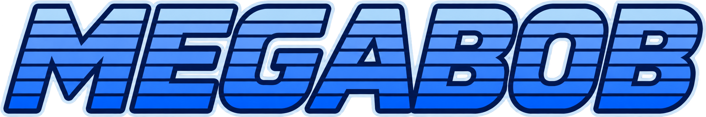

# MegaBob

[](https://matheusdgc.itch.io/megabob)

Um jogo de plataforma e ação em **16 bits**, estrelado pelo **IBM Bob**, em uma cidade cyberpunk tomada por bugs de software. Explore as fases, enfrente chefes robóticos e use as armas conquistadas para descobrir novos caminhos.

**[Jogue MegaBob no navegador](https://matheusdgc.itch.io/megabob)**

Gratuito, sem instalação e com interface em português. Jogue com teclado ou gamepad; os controles podem ser remapeados no menu **Opções**.

## Como surgiu

O MegaBob nasceu durante um workshop sobre o IBM Bob, a partir do desafio de criar um jogo em três dias. O mascote foi o ponto de partida para uma aventura inspirada nos clássicos de plataforma e ação, com cenários, inimigos e chefes próprios baseados em conceitos de programação.

## A aventura

Bob precisa enfrentar três bugs para liberar a fortaleza de **Tech Debt**. Você escolhe a ordem das primeiras fases, ganha uma arma ao vencer cada chefe e pode voltar para explorar os caminhos que ficaram para trás.

| Fase | O que espera por você |
|---|---|
| **Memory Leak** | Um data center inundado, lodo crescente e a arma Garbage Collector. |
| **Race Condition** | Esteiras, plataformas móveis e a arma Mutex Lock. |
| **Null Pointer** | Blocos que desaparecem, passagens ocultas e tiros que atravessam paredes finas. |
| **Tech Debt** | A fortaleza final, liberada após derrotar os três primeiros chefes. |

Durante a aventura, encontre as quatro peças da **Armadura Firmware**, explore as fraquezas entre chefes e combine pulo, dash e movimentos de parede para atravessar os obstáculos.

O jogo conta com checkpoints, progresso salvo no navegador, quadro de recordes local e ajustes de volume, tremor de tela e flashes. O dash no ar é liberado pelas **Turbo Boots**.

## Telas do jogo

### Menu inicial


### Em ação


### Combate contra Memory Leak


## Controles padrão

| Ação | Teclas |
|---|---|
| Mover | Setas ou WASD |
| Pular | Espaço |
| Atirar / carregar | Z ou L; segure para carregar e solte para disparar |
| Dash | C ou Shift esquerdo |
| Trocar arma | Q / E ou vírgula / ponto |
| Pausar | Esc ou P |
| Confirmar nos menus | Enter, pulo ou tiro |
| Ativar / desativar som | M |

O menu **Opções**, acessível pelo título e pela pausa, permite remapear teclado e gamepad. O progresso e as configurações ficam salvos localmente: mudar de navegador ou limpar seus dados não transfere o save.

## Executar localmente

O ambiente de desenvolvimento usa **Node.js 26** e npm. Com o repositório disponível na sua máquina:

```sh
npm ci
npm run dev
```

Abra [http://localhost:5173](http://localhost:5173). Para gerar e conferir o build de produção:

```sh
npm run build
npm run preview
```

O build estático fica em `dist/`.

## Tecnologias e desenvolvimento

O jogo usa **Phaser 3.90**, **TypeScript**, **Vite** e **Vitest**. A resolução interna é de **480 × 270**, com escala inteira para preservar o visual retrô.

As regras de movimento, combate e progresso ficam em `src/systems/`; os dados e ajustes ficam em `src/data/`; as fases são declaradas em `src/stages/`. Cenas e entidades conectam essas regras à renderização e à física do Phaser.

Para validar o projeto:

```sh
npm test
npm run typecheck
npm run build
```

Para preparar o pacote HTML5 do itch.io:

```sh
npm run package:itch
npm run check:release
```

O pacote é gerado em `release/megabob-html5.zip`. A página publicada usa um embed de **960 × 540**, com início por clique e opção de tela cheia. Os detalhes de configuração e verificação estão no [guia do itch.io](docs/itchio.md).

## Documentação

- [Especificação do jogo](SPEC.md)
- [Plano de implementação](tasks/plan.md) e [tarefas](tasks/todo.md)
- [Estado atual e próximos passos](docs/HANDOFF.md)
- [Como construir fases](src/stages/README.md)
- [Pipeline de arte](docs/art-pipeline.md) e [prompts das imagens](docs/art-prompts.md)
- [Trilha sonora e licenças](docs/soundtrack.md)
- [Tema integrado da página no itch.io](art/marketing/itch-theme/README.md)

## Créditos

**Design e código:** [Matheus D. Gomes](https://github.com/matheusdgc), com o assistente de código **[IBM Bob](https://www.ibm.com/ibm/ibmbob.html)**.

Todo o código-fonte — arquitetura, sistemas de jogo, lógica de física, máquinas de estado, IA dos inimigos e chefes, UI, áudio e testes — foi escrito exclusivamente pelo **IBM Bob** (IA da IBM). O ChatGPT/DALL-E foi utilizado apenas para a **geração das imagens** (sprites, tilesets, fundos e interface), que foram depois processadas pelo pipeline `tools/art.py`.

**Personagem:** IBM Bob — propriedade da IBM Corporation, utilizado com permissão para este projeto.

As músicas mantêm seus autores e licenças nos créditos do jogo e em [docs/soundtrack.md](docs/soundtrack.md). As licenças das dependências continuam pertencendo aos respectivos projetos.
